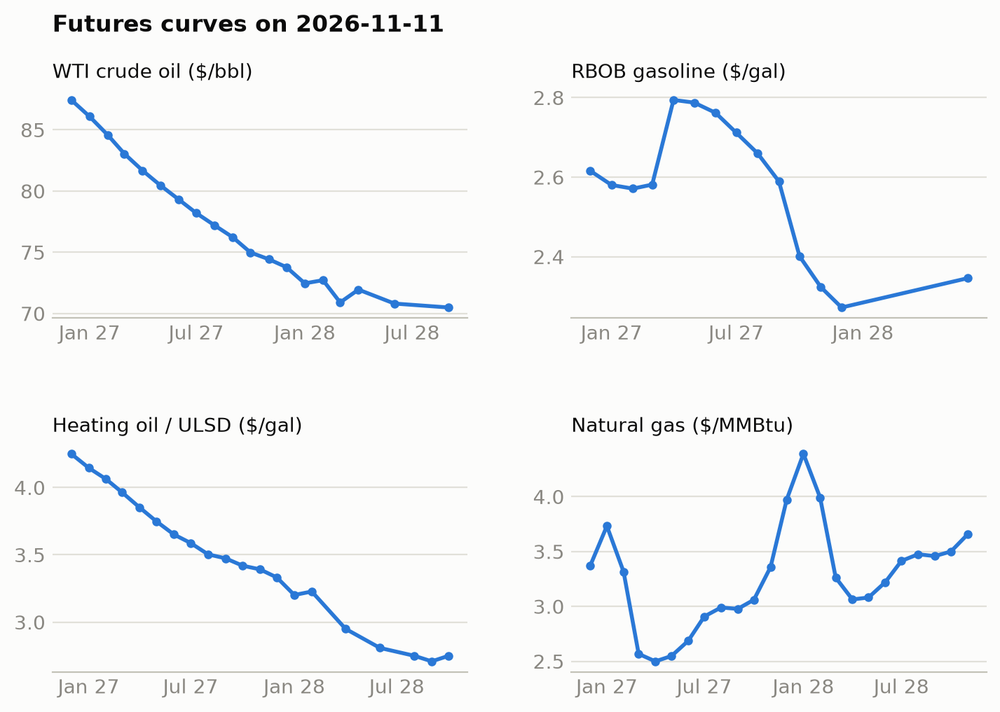
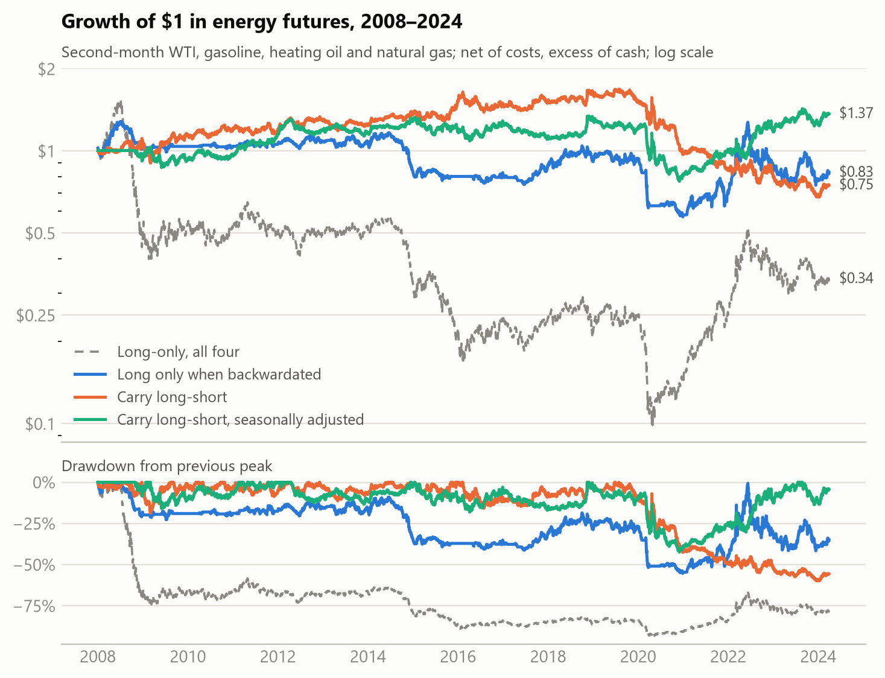
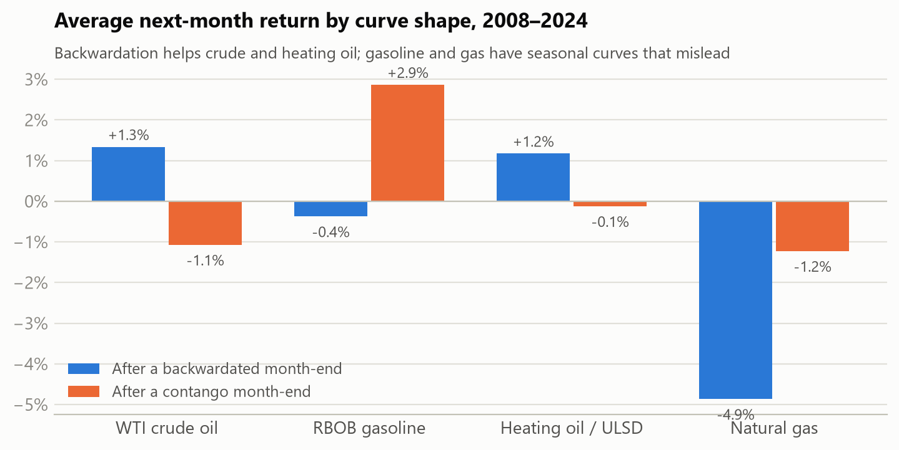
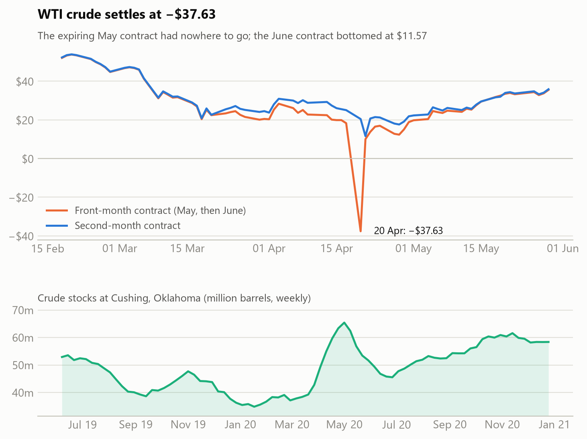
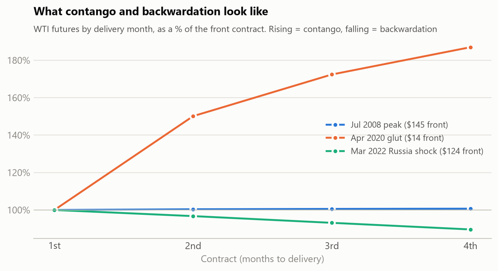

# oil-futures-curves

[](https://github.com/cristianahobbs/oil-futures-curves/actions/workflows/tests.yml)
[](https://github.com/cristianahobbs/oil-futures-curves/actions/workflows/daily.yml)

What does the shape of the oil futures curve tell you, and what does it cost you as an investor?

This repo tracks the futures curves for WTI crude, RBOB gasoline, heating oil (ULSD) and natural gas.
It has three parts:

1. **A daily brief.** Every weekday evening a GitHub Action pulls today's curves, spot prices, Cushing
   stocks and energy headlines, and updates the section below.
2. **A carry backtest.** Does a backwardated curve predict returns, and can you trade on it?
   Tested on daily data from 2008 to 2024.
3. **A case study of 20 April 2020**, the day WTI settled at −$37.63.

There is also a [Streamlit app](#curve-explorer-app) for looking at the curve on any date since the 1980s.

**Key terms.** A futures curve is the price of the same commodity for delivery in different months.
- **Contango:** later months cost more. The usual state when supply is plentiful and storage costs money.
- **Backwardation:** later months cost less. The usual state when supply is tight.

## Today

<!-- today:start -->
### Energy brief: Wednesday 11 November 2026

**Curves and signals** (futures from Yahoo Finance; carry is the annualised slope between the 2nd and
4th listed contracts, the same definition as the backtest)

| | Front month | 12th month | Curve | Carry vs 5-year norm for November | Long only when backwardated | Carry long-short |
|---|---|---|---|---|---|---|
| WTI crude oil | $87.44 (Dec 2026) | $74.43 | backwardation (+21.6%) | +19.8% | long | long |
| RBOB gasoline | $2.616 (Dec 2026) | $2.323 | flat (-0.2%) | +4.5% | flat | short |
| Heating oil / ULSD | $4.250 (Dec 2026) | $3.392 | backwardation (+26.8%) | +17.3% | long | short |
| Natural gas | $3.37 (Dec 2026) | $3.36 | backwardation (+224.5%) | +155.3% | long | long |

**Spot** (EIA, as of 03 Nov 2026). Brent trades $7.39 above WTI.

| | Price | 1 week | 1 month |
|---|---|---|---|
| WTI | $99.64 | -3.6% | +1.8% |
| Brent | $107.03 | -13.1% | -21.0% |

**Cushing crude stocks** (EIA weekly, 30 Oct 2026): 27.2 million barrels,
+0.3 million on the week, vs 25.1 million on average for this week over the past five years.

**Headlines**

- [Gas prices for 11/11/26: What will you pay on Veterans Day?](https://news.google.com/rss/articles/CBMilwFBVV95cUxPcWdZQzZzVC1PSDJUMm54TFUzSTVablVOcjE0eGVHcE1fMllYa1JKSlQ3Yk9qWkZ4dXNSd2hvS1FrX0dLbTJuU2tYOTVxbEpHdG05TUwzeExEWmstRnNGR0FWZ19Vc2l4LUxZWWVuRHdlUTF2SWZ3UmR4ZFlzdmRiWGpxMU85a3g2YzFhQ2lQSGRIcHRHSVVz0gGrAUFVX3lxTFAyU2ZwRHc3TC1WMHZGLWdRSHpWMG9nRzZTVE1VUC0zaTBvdml3RTRmeDRxM1hKYlNuT3l5U1JKT2xVd3NST3ZwaU42T1NxczZnbWtzejhYR016ZzVuZjF5WVZqby1yWF9rbDQxaHV4dkxxNXBMWFd6d3ZQR0w2bExPMktYYmhBMlBzTlNYOE1LNjB2dUtISklxSXJwOE9iVEhHSnluMkFZNjRWTQ?oc=5) (AL.com)
- [Oil prices rebound as Iran tensions cloud prospects for peace deal](https://news.google.com/rss/articles/CBMiyAFBVV95cUxNMk15cjhtQnAyUmRpb1dQTFpEd2VIazZJRXlsVjkzcG9tTS1scUJSRFd1N0hobkdFQ2ozLUFZRWNlS2o5dHlNV0ZoWWNxRUJGRlJlYk9qSFFSTVJydzlmZ184VlBQOXJ2djF4QkFwdkJuQ19FUHgyQmN1Y04yakptYmRtamI0TFRGaUtodUZZVjMxNXNkaGUwQ0VJRHJXX2NHaWVzTEc1TU92Ykd1c3NySUkwQ1diTEI5QTZwcEFNaXVQSEtwNXQzdQ?oc=5) (TradingView)
- [Rupee closes at seven-month high of 93.69 as FPI inflows, lower crude prices boost sentiment](https://news.google.com/rss/articles/CBMi4gFBVV95cUxOUkduT1FDLWV1TVFPU00tU3lYVlJhQ01BcmMwX18yWDB3THhYTnpKQWlLNXNCM0F3MjRsRzFOZ2xSVFdTcEp4cVpDcnhNOWNlUVdVbm9NNnQ1Qi1Hc2xpWklXUlF3OEx4LTRRZHU2STUwMGptYlNTSHZfTmJ6SGxDQVhRQm44QWpfbzBpSjFkZlFESnVVc0NGSWs3M3ZWVXozWjY5Z0otTFotdWtuZVZ4NWRoNzlYaTFENnNGbTJGSF93b0V0VXRvVmxiTUZqU1p3UzNvTmRGWnBIN0dEOUZZM3pB?oc=5) (TradingView)
- [Gas prices dip below $4 nationwide for the first time since July—but the relief may be fragile](https://news.google.com/rss/articles/CBMie0FVX3lxTE94VmgwM3JLbTB3ZWF5X3lPdmd0QzI2LXJxbmVRUW5SUWVsZG9ub3FkQ3hMamR2cmNLZGZhX3JIRGQ3U3BrZjRtdXJYQW9HekVveUpOeXVCUzVLdVpPYmJLS3ZrS1JJYURiSHgxTmpiSFc3OWpMS2tZZHl3aw?oc=5) (Latin Times)
- [Diesel still costing close to a ’dismal’ £2 a litre despite oil price falls](https://news.google.com/rss/articles/CBMijwFBVV95cUxPdmRrX2dJN0NndlF0U3ctaTdvZndWUU9kWF9KVl9keW1oczBJalk4MFBrZW9vdFZ5NlU0UTVfWUZWb0U3enVZWGhGcU9oUnJxdEFDdmtkSGd2ZUpyQ3BDRi1TdlN2STF6SE9wWjliRk1rQnIzTElkZVVBYXFteHVPUlJJMGx3VFRHWTIwczhYNA?oc=5) (The Guardian)
- [Oil Prices Rebound as Hormuz Shipping Risks Persist](https://news.google.com/rss/articles/CBMilAFBVV95cUxPaGtVTlU3RUdyVVpfdDZjTGw2UVFYMGl2U0ZFMlVBZ19rd2J5UEw1aDR5dXJoRm5PS21Vcm1pTnA1aU9TbVVSN0lUWGlBTngtb3ZGRm1ZU1ZrZU16eFdDcnpZdUgxZWV0MzluN29sZld5TTVHVU5YR3E2MF8tdzJybXNoSTRwVDhFWFJ3QnhTaHQ1NllJ?oc=5) (grafa.com)
- [OPEC crude production rises by nearly 2 million bpd in October](https://news.google.com/rss/articles/CBMipwFBVV95cUxNSEJ6dHBjOWZVX1pCSDRGM0hNMkdPVUJWVkFQcUxmZHZRMGJXOEktRWJqM2ZvOGVvN3lWaWVubXpLekJKZl9qOW9ya0xwTHpaOTNXaXd5X3RvRW1HU0gtVy1tVGZQS1V3Q3VXZ191TnZYaUt5MDdsV0xQeG53SjFGN3dNblBoU0xGMDdZSXFCZHJPaHZFS1lWLU9oOVBpemY0d0VhM29Gd9IBrwFBVV95cUxOb1p4SkhjR0g0eHJlX24xd1VEck50SURxNjZwWmd0R1JwTE9iS0FEOXpRMldqNjVnUzVhT01sVWRvRkRtNWNxM1RicGFMUTVSdEJhdW5WNlZ0WWZiREZ2bFItNTV2RFUwT1dDRDduZnhCVlZvd2x6YkR4T0I4OWFsVU0xRlh2TjBZODktMGFQRUE2R2NBdmJmVnZwbzZvS0o4Z2dxUlJ4dTExZHVjMzY4?oc=5) (Anadolu Ajansı)
- [Oil Prices Rebound as Middle East Supply Risks Persist](https://news.google.com/rss/articles/CBMipgFBVV95cUxOMG9QUTRTOFdKeFlQeU5fLTdmZnJjdllnZFFQb0tRcU4wOGUxaDdkUThaMERudUlRM3hyalVvMVVVZHJkZUM2OWVSWXR5ZThzSEVEOGo0WjdncmVET1NtcHZ3a1ZScFZTaGt4dlpWYnlMRGtpT3ZoM3p0cWhmN1FCNHk1LTI0dGxHMDZwQmpxcDgtSmNQNzNOZFJqbFFDVE44OVNYcERB?oc=5) (WSJ)

**From EIA**

- [U.S. crude oil imports from Venezuela in July were highest since 2017](https://www.eia.gov/todayinenergy/detail.php?id=68425)
- [Refineries have shifted production away from gasoline to middle distillates](https://www.eia.gov/todayinenergy/detail.php?id=68424)
- [Global refinery inputs fell sharply in the second quarter of 2026 before modest recovery](https://www.eia.gov/todayinenergy/detail.php?id=68404)

<sub>Signals follow the rules tested in this repo. The backtest shows they are weak, so treat them as
a description of the curve, not a recommendation. Not investment advice.</sub>

[Previous briefs](docs/daily/)
<!-- today:end -->

<picture>
  <source media="(prefers-color-scheme: dark)" srcset="docs/charts/live_curves-dark.png">
  
</picture>

## Findings

<!-- findings:start -->
**What owning oil through futures actually earned.** Anything that holds futures (most oil and gas ETFs and ETCs) earns the futures return, not the price change. In contango every roll sells the cheap expiring contract and buys a dearer one.

| | Front-month price, per year | Holding rolled futures, per year | Difference (roll yield) |
|---|---|---|---|
| WTI crude oil | -1.1% | -8.8% | -7.7% |
| RBOB gasoline | +0.4% | +3.6% | +3.1% |
| Heating oil / ULSD | -0.3% | -0.3% | -0.0% |
| Natural gas | -8.8% | -29.8% | -21.0% |

**Carry strategies.** Backtest 2008-01 to 2024-03, daily data, monthly rebalancing, second-month contracts, net of costs, excess of cash. Generated by `python main.py`; raw numbers are in [`output/`](output/).

| | Long-only, all four | Long only when backwardated | Carry long-short | Carry long-short, seasonally adjusted |
|---|---|---|---|---|
| Annual return | -6.4% | -1.1% | -1.8% | 1.9% |
| Volatility | 30.3% | 16.4% | 13.6% | 13.1% |
| Sharpe | -0.07 | 0.01 | -0.06 | 0.21 |
| t-stat (Newey-West) | -0.26 | 0.03 | -0.37 | 0.90 |
| Max drawdown | -93.6% | -55.3% | -59.8% | -42.4% |
| Worst month | -38.4% | -24.3% | -16.1% | -17.4% |
| Annual turnover | 0.9x | 2.2x | 6.5x | 7.2x |

**By commodity.** Does a backwardated curve at month-end predict next month's return?

| | Share of months backwardated | Next-month return, backwardated | Next-month return, contango | Sharpe, always long | Sharpe, long only when backwardated |
|---|---|---|---|---|---|
| WTI crude oil | 40% | +1.3% | -1.1% | -0.02 | 0.33 |
| RBOB gasoline | 61% | -0.4% | +2.9% | 0.28 | -0.12 |
| Heating oil / ULSD | 41% | +1.2% | -0.1% | 0.16 | 0.26 |
| Natural gas | 22% | -4.9% | -1.2% | -0.52 | -0.49 |

Historical simulation, not investment advice.
<!-- findings:end -->

<picture>
  <source media="(prefers-color-scheme: dark)" srcset="docs/charts/equity-dark.png">
  
</picture>

<picture>
  <source media="(prefers-color-scheme: dark)" srcset="docs/charts/predictive-dark.png">
  
</picture>

**What this means for an investor:**

- **Holding oil through futures has been expensive.** Contango made the rolled WTI position lose about
  8 points a year more than the price itself fell. Natural gas was much worse. Before buying a
  commodity ETF or ETC, check the curve. If it's in steep contango, the price has to rise just for you
  to break even.
- **Backwardation is a mildly useful signal for crude and heating oil, not a strategy on its own.**
  Holding WTI only while its curve was backwardated raised its Sharpe ratio from about 0 to 0.3.
  Across all four commodities the effect is not statistically significant.
- **Gasoline and natural gas curves are seasonal.** Gasoline costs more for summer delivery and gas
  for winter. The raw slope of those curves mostly measures the calendar, which is why carry pointed
  the wrong way for them. Comparing today's slope with the usual slope for the same month (the
  "seasonally adjusted" strategy) fixes some of this.

## 20 April 2020: when oil cost less than nothing

<picture>
  <source media="(prefers-color-scheme: dark)" srcset="docs/charts/april_2020-dark.png">
  
</picture>

On 2 January 2020 the WTI curve was almost flat, at around $61 for each of the first four months.
Then COVID-19 lockdowns cut demand while production kept flowing, and the extra crude had to be stored.
WTI futures are settled by physical delivery at Cushing, Oklahoma. Crude stocks there rose from
**37.2 million barrels** at the end of February to **65.4 million** by 1 May.

The May contract expired on 21 April. Anyone still holding it then had to take delivery of oil at
Cushing, and with storage almost full, almost nobody could. On 20 April, holders sold at any price,
and the contract settled at **−$37.63**, down from $18.27 the previous day. The June contract settled
at **$20.43** the same day, $58 above May. The problem was in one contract and one location, not the
oil market as a whole.

The case study shows two lessons for investors:

- **Which contract you hold matters.** A position in the front-month contract lost 306% of its value
  in one day; it ended the day owing money. A position in the second month lost 58% from 1 March to
  20 April, which was painful but never negative. This is why the backtest holds the second contract
  and rolls before expiry. Commodity indices and ETFs follow similar rules.
- **The curve warned you.** By 20 April, the annualised slope between the 2nd and 4th contracts was
  about −200%: the market was charging heavily to store oil for later.

<picture>
  <source media="(prefers-color-scheme: dark)" srcset="docs/charts/snapshots-dark.png">
  
</picture>

## Method

| | |
|---|---|
| History | Daily NYMEX settlements for contracts 1–4 from the [EIA](https://www.eia.gov/dnav/pet/pet_pri_fut_s1_d.htm), cached in [`data/futures.csv`](data/futures.csv). EIA stopped publishing these on 5 April 2024, so the backtest ends in March 2024. |
| Today's curves | Last prices for each listed contract from Yahoo Finance, refreshed daily. |
| Spot and stocks | WTI and Brent spot prices, and weekly Cushing crude stocks, from the EIA. |
| Contract rolls | EIA labels contracts by position, not delivery month. [`curves.py`](curves.py) rebuilds each contract's expiry date from the exchange rules, so returns never mix two different contracts. A test checks that on predicted roll days the price gaps between contracts shift by one in over 80% of cases, against under 25% on other days. |
| Position | The second-month contract, rolled when it becomes the front month. It is never held into expiry. |
| Carry | Annualised slope between contracts 2 and 4: ln(C2 / C4) × 6. Positive means backwardation. |
| Seasonal adjustment | Carry minus its average for the same calendar month over the previous five years. Only past data is used. |
| Strategies | Rebalanced at each month-end and sized by inverse 60-day volatility. Long-short holds the two highest-carry commodities long and the two lowest short. |
| Costs | 5 bps per unit traded at rebalancing, plus 2 bps per roll. |

## Limitations

- Four commodities is a small universe. Published carry studies use 20 or more futures across energy,
  metals and agriculture, where carry works better because the commodities are less correlated.
- Returns are excess returns: they leave out the interest earned on collateral.
- EIA history stops in April 2024. Yahoo only covers contracts that are still trading, so the
  2024–2026 period can't be backtested from free data.
- The seasonal adjustment needs three years of history, so it starts later for gasoline (from 2008).

## Curve explorer app

```bash
pip install -r requirements.txt
streamlit run app.py
```

Pick a commodity and a date to see the first four contracts that day, labelled with their delivery
months. You can compare two dates, view today's full curve, or browse the month-end carry history.
Presets include the 2008 peak, April 2020 and March 2022.

## Run it

```bash
python main.py               # backtest and case study; rewrites the Findings section
python charts.py             # README charts
python update.py             # today's brief: live curves, spot, Cushing, headlines; rewrites Today
python -m unittest discover -s tests -v
```

| File | |
|---|---|
| [`data.py`](data.py) | EIA and Yahoo downloads with on-disk cache |
| [`curves.py`](curves.py) | Expiry calendar, roll-adjusted returns, carry, seasonal adjustment |
| [`strategy.py`](strategy.py) | Signals, monthly portfolio simulation with costs, statistics |
| [`main.py`](main.py) | Backtest, robustness checks, roll cost and 2020 case study; writes `output/` |
| [`update.py`](update.py) | Daily brief, run by [`.github/workflows/daily.yml`](.github/workflows/daily.yml) |
| [`app.py`](app.py) | Streamlit curve explorer |

Headlines link to their publishers through Google News. EIA articles are from
[Today in Energy](https://www.eia.gov/todayinenergy/). Nothing here is investment advice.

## References

- Koijen, R., Moskowitz, T., Pedersen, L. H. and Vrugt, E. (2018). Carry. *Journal of Financial Economics*.
- Gorton, G. and Rouwenhorst, K. G. (2006). Facts and Fantasies about Commodity Futures. *Financial Analysts Journal*.
- Erb, C. and Harvey, C. (2006). The Strategic and Tactical Value of Commodity Futures. *Financial Analysts Journal*.
